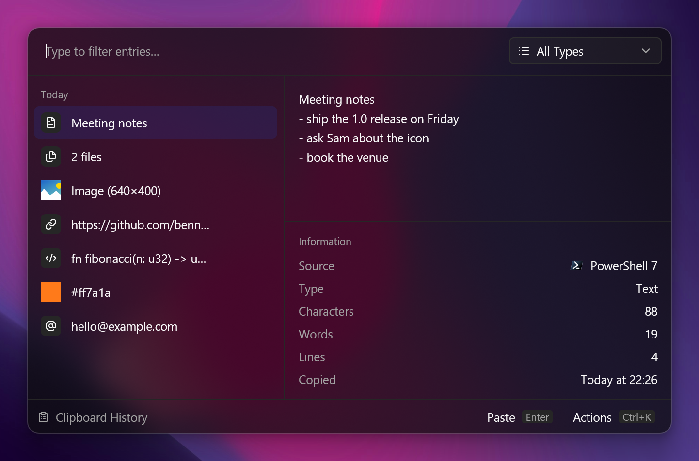
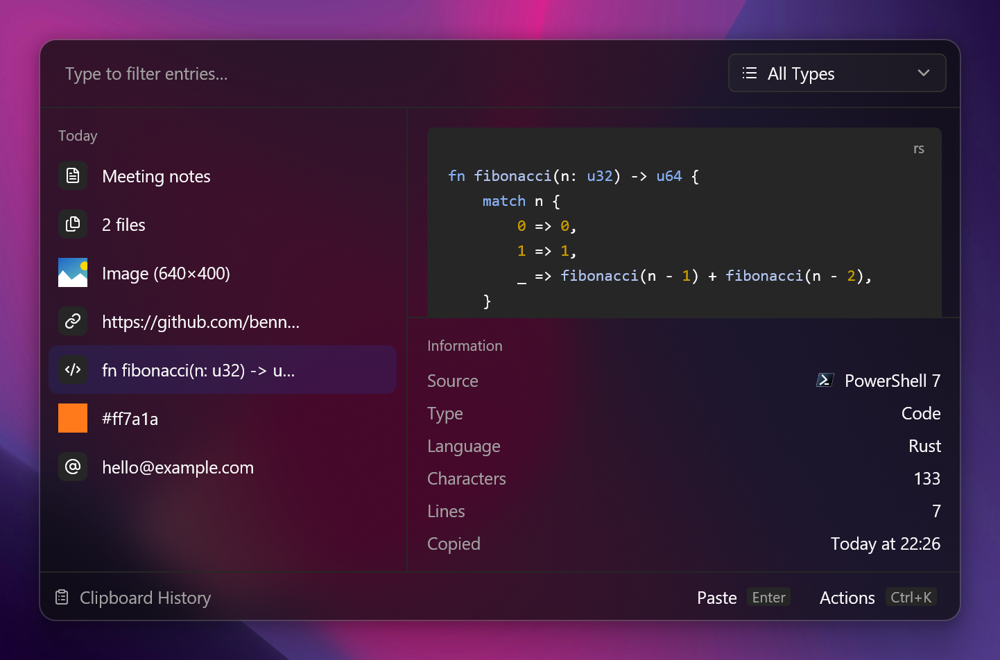
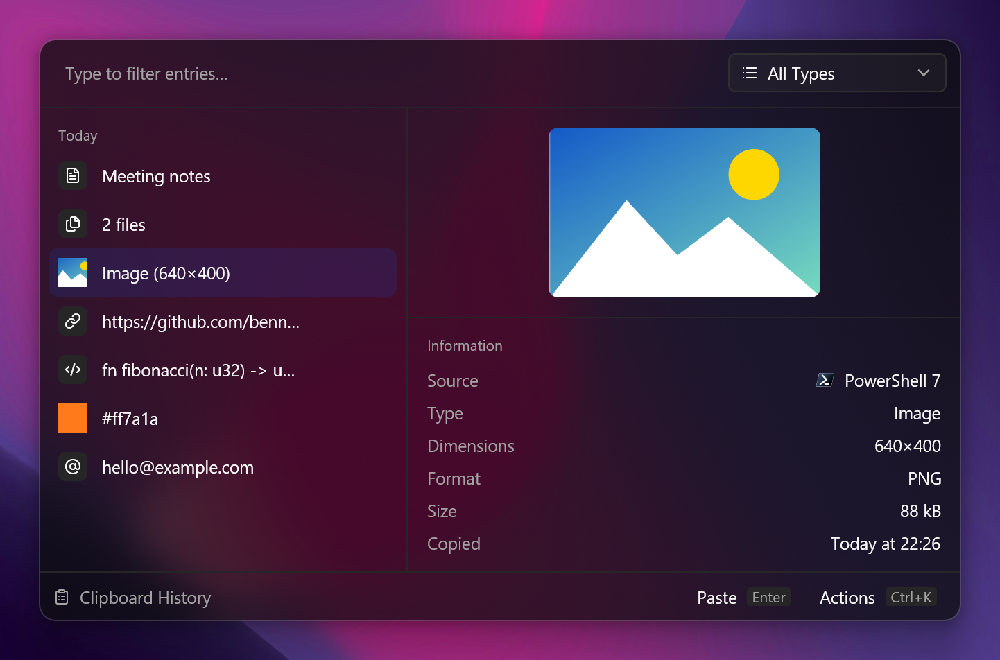
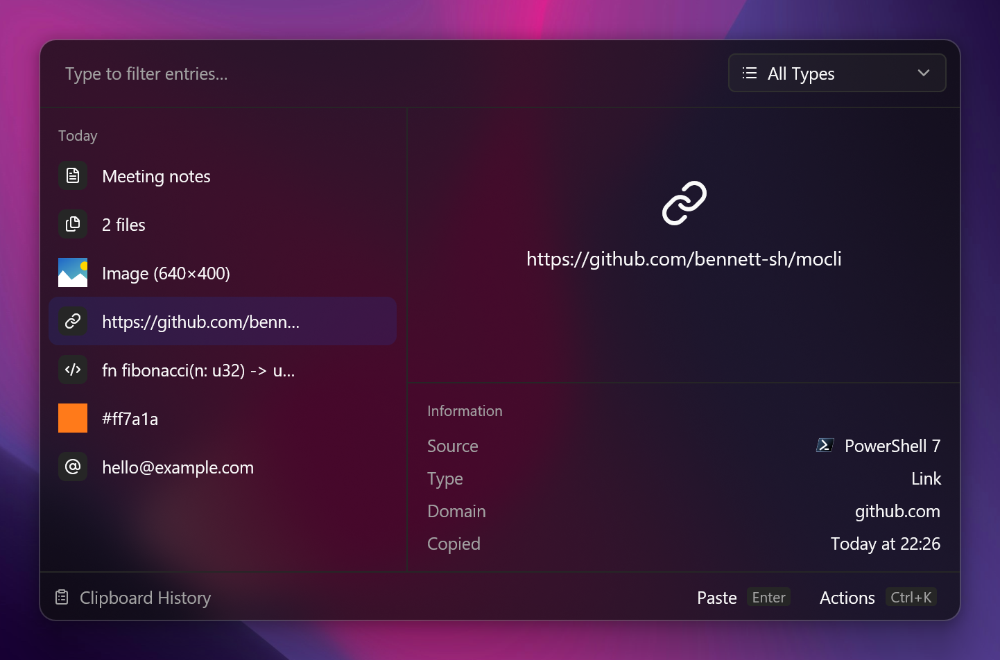
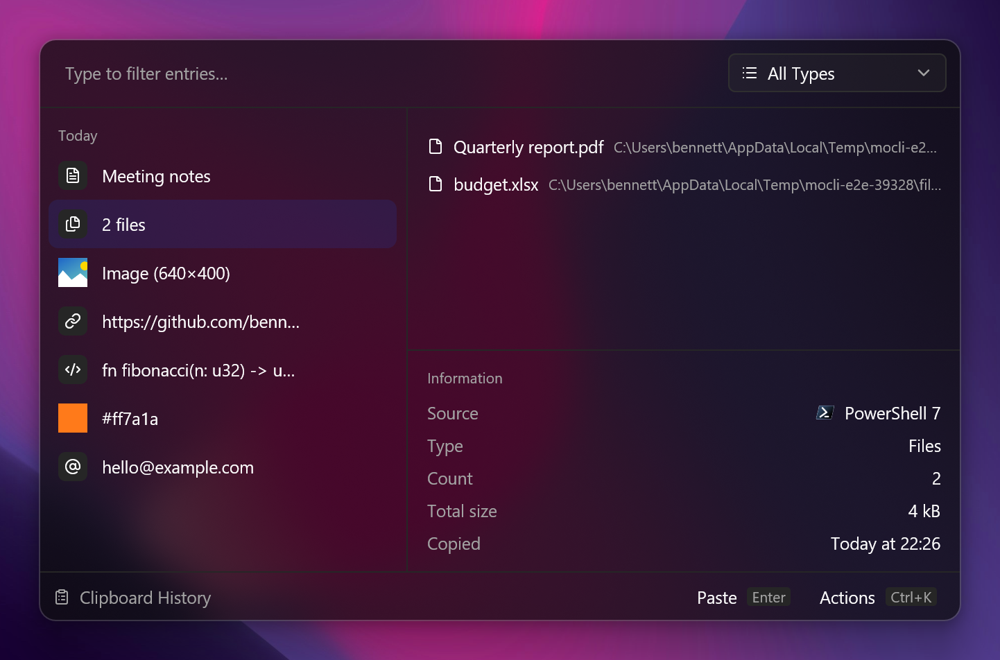
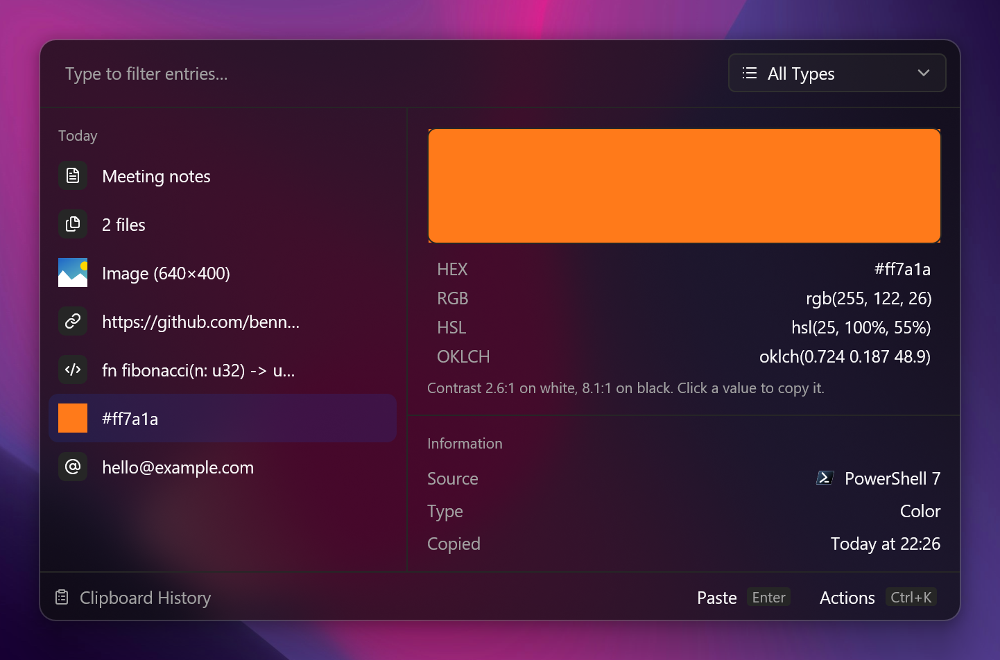
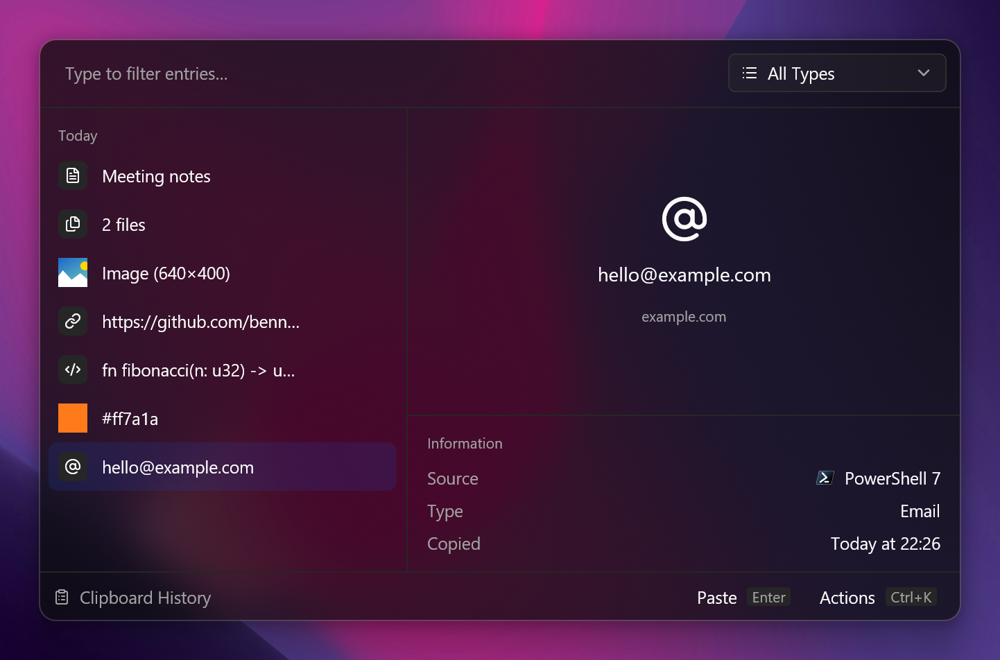
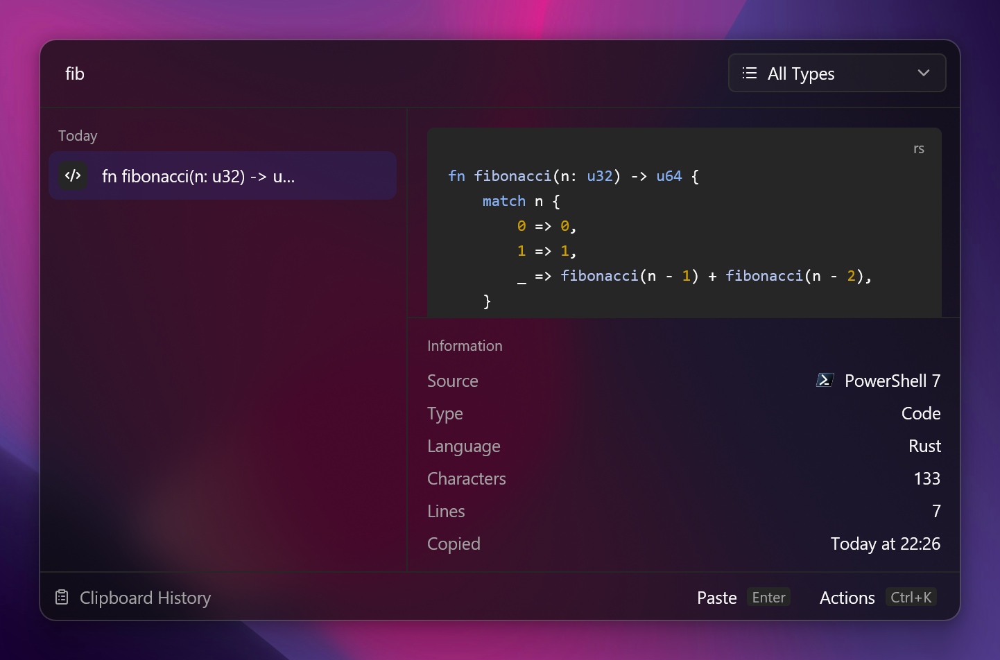
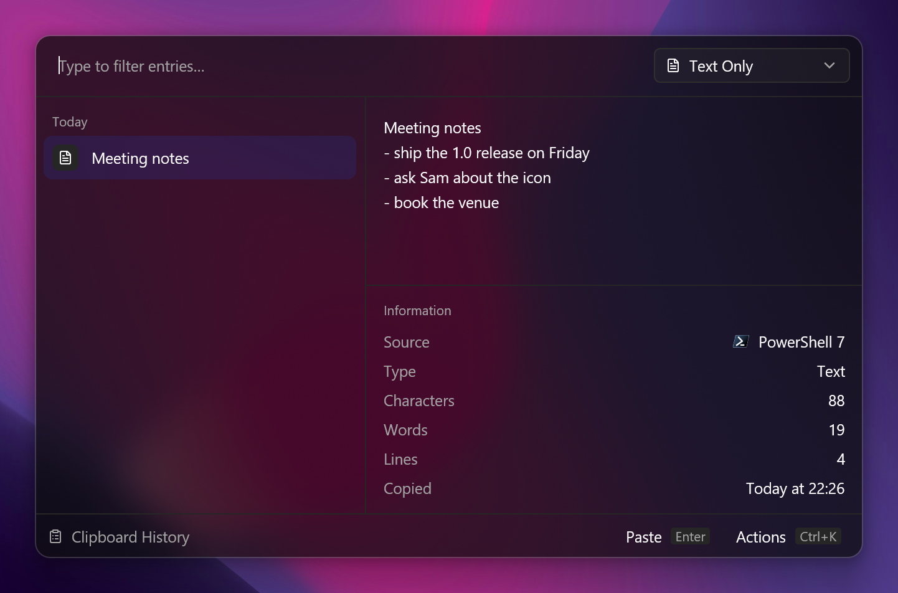
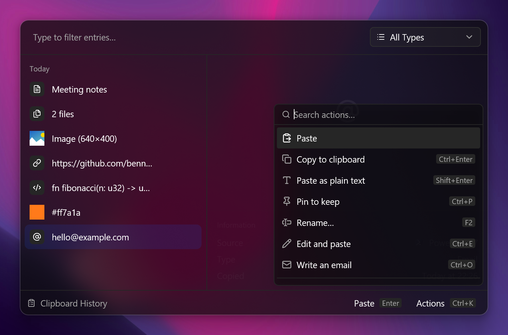

<div align="center">


# mocli

A super fast & modern clipboard history for Windows. Press `Win+V`: the
popup opens next to the text you are typing, **without taking focus**, and
`Enter` pastes. Built in Rust with [gpui-kit](https://gpui-kit.com).

[Install](#install) · [Features](#features) · [Use](#use) · [Settings](#settings) · [Privacy](#privacy) · [Develop](#develop)

<br>



</div>

> [!NOTE]
> **Disclaimers:**
> 1. This project is almost fully vibe-coded. It's primary function is to be a tool for myself, as I so far have not found any performant, "out-of-the-way", visually-pleasing clipboard managers that just work. While I'm usually against vibe-coding, this project (in my opinion) is not sloppy and so far has been super helpful in my workflows. I have not verified the encryption feature myself and therefore it should be taken as a nice-to-have and NOT a guarantee for protection and may result in permanent data loss.
> 2. The design is heavily inspired by Raycast's Clipboard History. Please feel encouraged to check it out and support them if you prefer their implementation.

## Install

Download from [Releases](https://github.com/bennett-sh/mocli/releases):

- `mocli-<version>-x64-setup.exe` installs for the current user, no
  administrator rights needed.
- `mocli-<version>-x64-portable.zip` runs from any folder and keeps its
  settings and history in a `data` folder next to it.

Windows 10 2004 or later, 64-bit. The builds are not code signed, so SmartScreen
asks before the first start.

## Features

<table>
<tr>
<td width="50%"></td>
<td width="50%"></td>
</tr>
<tr>
<td valign="top"><b>Knows what you copied.</b> Text, code, links, email addresses, colors, images, SVG and files each get their own icon and preview, and show the program they came from.</td>
<td valign="top"><b>Images included.</b> Pictures are shown at full size next to their dimensions, format and size, and the text in them is searchable.</td>
</tr>
<tr>
<td></td>
<td></td>
</tr>
<tr>
<td valign="top"><b>Links.</b> Open them with <code>Ctrl+O</code>. Page titles and pictures are only fetched if you switch on link previews.</td>
<td valign="top"><b>Files.</b> Copied files are listed together, and can be opened or shown in Explorer.</td>
</tr>
<tr>
<td></td>
<td></td>
</tr>
<tr>
<td valign="top"><b>Colors.</b> A copied color shows as a swatch.</td>
<td valign="top"><b>Email addresses.</b> One action writes an email to the address.</td>
</tr>
<tr>
<td></td>
<td></td>
</tr>
<tr>
<td valign="top"><b>Search as you type.</b> It finds the text of every entry, the text in images, and names you gave entries with <code>F2</code>.</td>
<td valign="top"><b>Filter by type.</b> <code>Tab</code> and <code>Shift+Tab</code> switch between all entries, text, links, images and so on.</td>
</tr>
<tr>
<td colspan="2" align="center"><br><b>Everything one key away.</b> <code>Ctrl+K</code> lists every action for the selected entry with its shortcut: paste, copy, paste as plain text, pin, rename, edit and paste, and more for the kind of entry.</td>
</tr>
</table>

## Use

| Key | Action |
|---|---|
| type | Search (including text found in images) |
| `↑` `↓` `PgUp` `PgDn` | Move through the list |
| `Enter` / `Ctrl+Enter` | Paste / copy only |
| `Shift+Enter` | Paste as plain text |
| `Ctrl+1` … `Ctrl+9` | Paste that entry |
| `Ctrl+K` | All actions for the entry |
| `Ctrl+P` | Pin to keep, or unpin |
| `Ctrl+Backspace` / `Del` | Delete (with an empty search) |
| `Ctrl+E` | Edit, then paste |
| `F2` | Name the entry (search finds the name and the content) |
| `Ctrl+O` | Open the link, file or image |
| `Tab` / `Shift+Tab` | Change the type filter |
| `Ctrl+,` | Settings |
| `Esc` | Clear the search, then close |

It keeps text, code, links, email addresses, colors, images, SVG and files, each
with a preview and the program it came from.

## Settings

Open them from the tray icon or with `Ctrl+,`, or edit
`%APPDATA%\mocli\config.toml`; changes apply as soon as the file is saved.

## How long entries are kept

Entries are deleted 3 months after they were last copied. "Keep history for" in
the History settings also offers 1, 6, 12 and 24 hours, 3 days, 1 week, 1 month
and forever (`keep_for` in the config file). Separately, only the newest 1000
entries stay unless you change that limit.

`Ctrl+P` pins an entry: it stays where it is in the list and is kept beyond both
limits until you delete or unpin it. An unpinned entry that is already too old
is deleted within a minute.

## Privacy

- The history stays in `%LOCALAPPDATA%\mocli`. You can
  [encrypt](#encryption) it.
- Content that apps mark as private is never saved, nor are copies from
  1Password, Bitwarden and KeePass, nor anything that looks like a card number,
  private key or access token. These checks cannot catch every secret; pause
  capture from the tray when in doubt.
- Nothing leaves your computer. The exceptions are link previews, which are
  off unless you switch them on, and a daily look at GitHub for a newer
  release, which you can turn off in the installer or under About in the
  settings (`[updates] check = false`). An update is only offered in the tray
  menu and the settings; nothing is downloaded or installed by itself.

## Encryption

Encryption is off unless you switch on "Encrypt history" in the Privacy settings
(`encrypt_history = true`), and takes effect after restarting mocli.

> **You can lose your history.** The key is tied to your PC and Windows account.
> If the TPM chip is cleared or replaced, Windows is reinstalled, an
> administrator resets your password, or you move to another PC or account,
> nobody can recover an encrypted history, pinned entries included. mocli then
> asks whether to start a new one, and keeps the unreadable files.

When on, the database (SQLCipher, AES-256) and the picture files (XChaCha20-Poly1305) are
encrypted with a random key. That key is wrapped by an RSA key that is created
inside the TPM chip and cannot be exported, and the result is sealed to your
Windows account. There is no password to type. A PC without a usable TPM relies
on the Windows account alone; the Privacy settings say which is in use.

- It protects the files: a stolen disk, a copied folder, a backup or another
  user cannot read them.
- It does **not** protect against software running as you while you are signed
  in, which can ask for the key just as mocli does.
- Opening a stored picture in another program leaves a readable copy until mocli
  next starts or quits. "Save image" writes a readable file where you choose.
- Turning encryption on or off converts the existing history. Old unencrypted
  data is deleted, but may remain recoverable from the disk for a while.
- An encrypted portable copy can only be read on the PC that wrote it.

## Limitations

- Programs running as administrator neither receive pasted text nor trigger the
  shortcut.
- Input methods (for example Chinese or Japanese) need the "focus moves to the
  popup" setting.

## Develop

Besides Rust and the MSVC build tools, the build needs Perl, to compile OpenSSL
for SQLCipher: [Strawberry Perl](https://strawberryperl.com) works. If another
Perl comes first on your `PATH`, set `OPENSSL_SRC_PERL` to Strawberry's
`perl.exe`.

```powershell
cargo run
cargo test
pwsh scripts/package.ps1 -SkipInstaller   # portable zip in dist/
```

End-to-end checks drive the real app with real input, so they need an unlocked,
idle desktop:

```powershell
cargo build; pwsh -STA -File scripts/e2e-popup.ps1
```

The others are `scripts/e2e-capture.ps1` and `scripts/e2e-placement.ps1`.

## Releases

Work happens on `dev`; pushing it lints, tests and builds the portable zip and
the installer. Pull requests are only linted and tested.

Pushing `main` does the same, then publishes the version in `Cargo.toml` as the
release `v<version>` with a changelog from the commit messages. If that release
exists, it is deleted and created again, so only a version bump adds a release.

Commit messages follow `type(scope): description` (`feat`, `fix`, `perf`,
`refactor`, `docs`, `test`, `build`, `ci`, `chore`, `style`; `!` marks a
breaking change). Others are listed under "Other changes".
